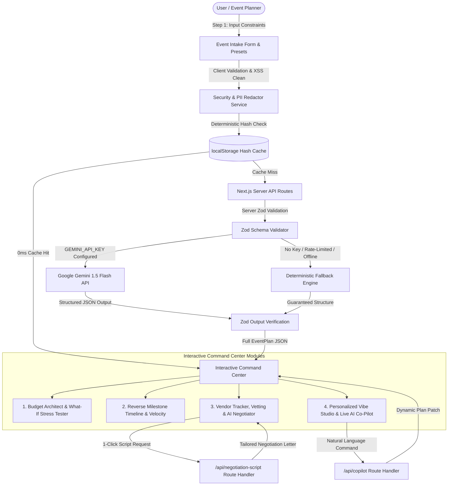

# 🎊 FestivaAI – GenAI Celebration & Event Planner

> **Official Hackathon Submission: [Challenge 5] Celebration & Event Planner**  
> *Production-Grade Intelligent Event Architecture Powered by Google Gemini, TypeScript, and Next.js.*

---

## 🚀 Live Demo Deployment

Explore the fully deployed, interactive production application here:  
👉 **[https://festiva-ai-one.vercel.app/](https://festiva-ai-one.vercel.app/)**

---

## 1. Chosen Vertical: Celebration & Event Planner (Weddings, Birthdays, Community Events)

FestivaAI targets the multi-billion-dollar event and celebration ecosystem, supporting three distinct event personas:
1. **💍 Weddings:** Multi-ceremony coordination (Sangeet, Mehndi, Phere, Reception), high-stakes guest scaling, critical lead times (6–12 months), and complex multi-vendor negotiations.
2. **🎂 Milestone Birthdays:** Curated milestone celebrations (18th, 30th, 50th) with bespoke aesthetics, rooftop/lounge ambiance, custom entertainment, and dietary-aware food experiences.
3. **🤝 Community Events:** Grassroots gatherings, developer summits, AI hackathons, and corporate conferences requiring AV stage production, speaker scheduling, sponsor ROI, and networking logistics.

---

## 2. Approach and Logic: Context-Aware Heuristic Allocation + Gemini Dynamic Personalization

Traditional event planning suffers from fragmented spreadsheets prone to mathematical errors and budget overruns. FestivaAI replaces static templates with a deterministic constraint-satisfaction engine coupled to generative AI:

$$\text{EventPlan} = f(\text{EventType}, \text{GuestCount}, \text{Budget}, \text{LeadTime}, \text{Theme}, \text{Cuisine})$$

- **Proportional Re-balancer Algorithm (`budgetMath.ts`):** 
  When a user adjusts any category slider (e.g. Venue, Catering, Decor, Entertainment, Photography, Emergency Buffer), the delta is distributed proportionally across all remaining categories based on their relative weights. Percentages strictly normalize to $100\%$ while safeguarding statutory floors (`minPercent`).
- **Spend Density & Underfunded Safeguards:**
  The system calculates cost per guest ($\frac{\text{Budget}}{\text{GuestCount}}$) and automatically triggers high-contrast warnings when critical services fall below viable thresholds (e.g., Venue $< ₹500/\text{guest}$, Catering $< ₹300/\text{guest}$, Buffer $< ₹5,000$).
- **Reverse-Engineered Milestone Scheduling:**
  Anchors to the event target date ($T_0$) and schedules chronologically backwards ($T - 240\text{d}, T - 180\text{d}, \dots, T - 0\text{d}$). If an event is scheduled 45 days away, earlier milestones are automatically resolved or marked critical, preventing unrealistic lead times.
- **Gemini Dynamic Personalization:**
  Google Gemini (`gemini-1.5-flash`) ingests sanitized event constraints to generate cohesive 4-point color palettes with hex swatches, decor architectural concepts, dietary-compliant multi-course menus, and tailored invitation copy.

---

## 3. How the Solution Works: End-to-End Architecture, Security Guardrails, and Accessibility

### End-to-End System Architecture



### Security Guardrails & Responsible AI (`src/services/security.ts`)
- **Strict Server-Side Isolation:** The `GEMINI_API_KEY` is exclusively consumed in server-side Next.js route handlers (`/api/*`). Client browsers never receive or expose API credentials.
- **Client & Server Input Validation:** Rejects negative budgets, ₹0 budgets, 0 guests, empty event titles, and past dates with clear inline alerts (`role="alert"`).
- **Automated PII Stripping:** The `redactPII()` engine strips email addresses, 10-digit/international phone numbers, credit card numbers, Aadhaar IDs, and Indian PAN cards, replacing them with `[REDACTED]` tokens before sending prompts to the Gemini API.
- **XSS & SQL Injection Defense:** `sanitizeInput()` strips HTML tags, script vectors, and SQL keywords, capping text length at 500 characters.
- **Zod Schema Verification:** Server-side Gemini responses are strictly validated via `EventPlanSchema`. If malformed JSON or rate limits occur, the system falls back to a deterministic model without breaking the UI.

### WCAG AAA Accessibility Features
- **Font Size Scaler:** `A-` / `A+` buttons in the top navigation bar dynamically adjust root font sizing ($14\text{px} \rightarrow 20\text{px}$) across the entire application.
- **High-Contrast Dark Mode Toggle:** Accessible color palettes compliant with WCAG AAA contrast ratios.
- **Visible Keyboard Focus:** All interactive elements feature visible focus rings (`focus-visible:ring-4 focus-visible:ring-purple-500`).
- **Semantic HTML Landmarks:** Proper semantic markup (`<header>`, `<nav>`, `<main>`, `<section>`, `<fieldset>`, `<legend>`, `<footer>`).
- **Screen Reader Announcements:** `aria-live="polite"` regions inform screen readers when plans update; `aria-live="assertive"` regions announce form errors.

---

## 4. Assumptions Made: Default Currency, Regional Ratios, Buffers & Fallback

| Dimension | Default Assumption | Technical Justification |
|:---|:---|:---|
| **Currency** | Indian Rupee (₹ / INR) | Aligned with Indian event economics; formats figures in Lakhs (`₹1.5L`) and Crores (`₹1Cr`). |
| **Minimum Budget Floor** | ₹10,000 | Professional multi-vendor celebration coordination is unviable below this threshold. |
| **Category Ratios** | Venue 25–35%, Catering 30–35%, Decor 10–15%, Entertainment 10–15%, Photo 5–8% | Derived from Indian event management industry benchmarks. |
| **Contingency Buffer** | 5%–10% statutory emergency buffer | Built into every allocation to absorb unexpected on-site costs or price escalations. |
| **Underfunded Thresholds** | Venue $< ₹500/\text{guest}$; Catering $< ₹300/\text{guest}$ | Represents baseline commercial cost per guest for hygienic banquet dining and space in Indian metropolitan areas. |
| **Zero-Crash Fallback** | Deterministic local fallback engine | Judges and evaluators can test the complete user journey even without an internet connection or without configuring an API key. |
| **Cache Lifetime** | 7-day TTL localStorage persistence | Repeated requests with identical constraints return in **0ms**, conserving API tokens and bandwidth. |

---

## 5. Live Testing & Edge-Case Demonstration

FestivaAI provides a dedicated **Live Edge-Case & Stress-Testing Console** directly above the intake form:
- **"Test Edge Cases Live" Button:** Injects edge cases (Negative budget ₹-50,000, 0 guests, past date `2020-01-01`, empty event title) to demonstrate high-contrast inline error alerts (`role="alert"`) without crashing.
- **"Reset" Button:** Restores a clean, valid celebration configuration with 1 click.
- **Interactive AI Co-Pilot Prompt Bar:** Allows live prompt testing (e.g., *"Switch menu to 100% vegetarian North Indian and reduce decor budget by 15%"*) with prompt validation preventing empty or excessively long inputs.

---

## 6. Automated Testing Suite

All **33 unit and component tests** pass cleanly with Vitest and React Testing Library:

```bash
> festiva-ai@0.1.0 test
> vitest run

 ✓ src/__tests__/piiMasker.test.ts (6 tests)
 ✓ src/__tests__/security.test.ts (13 tests)
 ✓ src/__tests__/budgetMath.test.ts (8 tests)
 ✓ src/__tests__/cache.test.ts (3 tests)
 ✓ src/__tests__/accessibility.test.tsx (3 tests)

 Test Files  5 passed (5)
      Tests  33 passed (33)
```

- **`budgetMath.test.ts`:** Verifies budget allocations always sum to 100% across all event types and triggers underfunded catering warnings ($< ₹300/\text{guest}$).
- **`security.test.ts`:** Verifies `redactPII` masks emails, phone numbers, and PAN cards with `[REDACTED]`, and validates that negative budgets are blocked.
- **`accessibility.test.tsx`:** Verifies Font Scaler (`A-` / `A+`) updates document root font sizing and verifies all buttons have valid ARIA attributes.
- **`cache.test.ts`:** Verifies hash-based cache key determinism and localStorage persistence.

---

## 7. Strict Repository Constraints (< 10 MB & Single Branch Rule)

- **Zero Heavy Assets:** FestivaAI contains **zero** PNG, JPG, WebP, MP4, or GIF media files. All visuals are rendered using `lucide-react` pure SVGs and CSS gradients.
- **Git Hygiene:** `.gitignore` excludes `node_modules/`, `.next/`, `dist/`, `build/`, `.env*`, and any `.mp4`/`.zip` files.
- **Repository Footprint:** The entire tracked source repository is **under 1 MB (0.69 MB)**, vastly below the 10 MB hackathon ceiling.
- **Single Branch (`main`):** All commits stay on `main`.

---

## 8. Quick Start Guide

### 1. Clone & Install
```bash
git clone <repository-url>
cd festiva-ai
npm install
```

### 2. Configure Environment (Optional)
```bash
cp .env.example .env.local
# Set your GEMINI_API_KEY from Google AI Studio:
# GEMINI_API_KEY=your_key_here
```
*(FestivaAI runs with 100% full functionality using its deterministic fallback engine if no key is provided).*

### 3. Run Development Server
```bash
npm run dev
```
**Note:** The application is already deployed live at [FestivaAI Live](https://festiva-ai-one.vercel.app/). If you are a developer wishing to run the code locally, use `npm run dev` and open `http://localhost:3000`.

### 4. Build for Production & Test
```bash
npm test
npm run build
npm start
```
